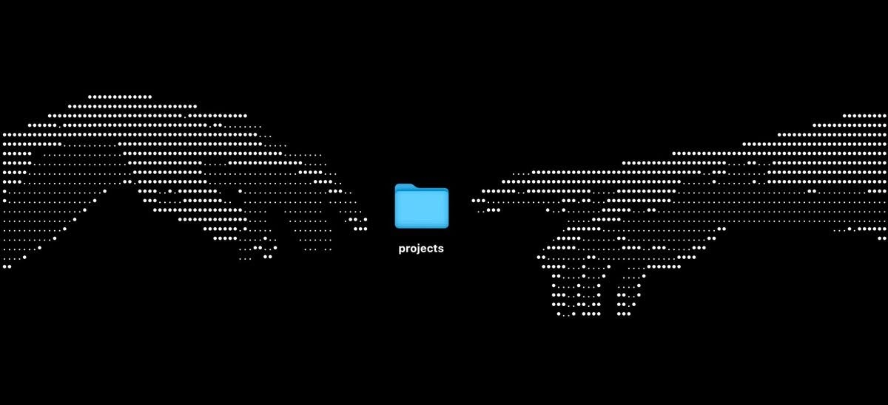
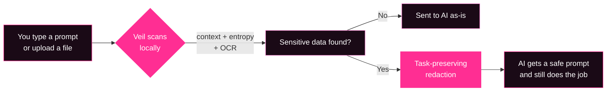
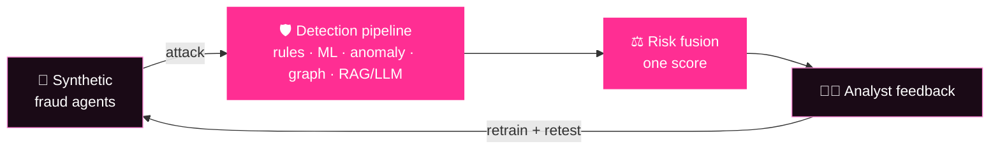

<p align="center">
  
</p><p align="center">
  
</p><h3 align="center">
Computer Engineering Student at VIT Pune <br>
Full Stack Developer • AI Enthusiast • Problem Solver
</h3><div align="center" style="margin: 14px 0 18px;">
  <svg width="100%" height="90" viewBox="0 0 1200 90" xmlns="http://www.w3.org/2000/svg" role="img" aria-label="Animated black wave banner">
    <defs>
      <linearGradient id="waveGlow" x1="0%" x2="100%" y1="0%" y2="0%">
        <stop offset="0%" stop-color="#00E676" stop-opacity="0.95"/>
        <stop offset="50%" stop-color="#FFFFFF" stop-opacity="0.82"/>
        <stop offset="100%" stop-color="#00E676" stop-opacity="0.95"/>
      </linearGradient>
    </defs>
    <rect width="1200" height="90" fill="#050505" rx="18"/>
    <path d="M0 48 C80 24, 150 24, 220 48 S380 72, 460 48 S640 22, 720 48 S900 72, 980 48 S1140 20, 1200 42 L1200 90 L0 90 Z" fill="#0E0E0E" opacity="0.95"/>
    <path d="M0 52 C95 18, 190 18, 270 48 S465 78, 550 52 S740 18, 820 48 S1015 78, 1085 52 S1165 24, 1200 44" stroke="url(#waveGlow)" stroke-width="4" fill="none">
      <animateTransform attributeName="transform" type="translate" values="0 0; 20 0; 0 0" dur="4.5s" repeatCount="indefinite"/>
    </path>
    <path d="M0 64 C110 34, 200 34, 290 64 S490 96, 580 64 S760 30, 860 64 S1060 96, 1160 64" stroke="#FFFFFF" stroke-width="2.5" opacity="0.75" fill="none">
      <animateTransform attributeName="transform" type="translate" values="0 0; -22 0; 0 0" dur="5.5s" repeatCount="indefinite"/>
    </path>
  </svg>
</div>

<!--
  PALETTE
  noir      #0B0610
  plum      #3A1030
  magenta   #FF2E93
  blush     #FF8AD8
-->

<!-- ✦ HERO ✦ -->

<p align="center">
  
</p>

<p align="center">
  
  
</p>

<p align="center">
  <a href="https://github.com/sameera-7-hash"></a>
  <a href="https://github.com/sameera-7-hash?tab=followers"></a>
  <a href="https://github.com/sameera-7-hash?tab=repositories"></a>
</p>

<!-- ✦ ABOUT ✦ -->


```ts
const sameera = {
  studying:     "B.Tech Computer Engineering @ VIT Pune (2025 → 2029)",
  buildsWith:   ["Python", "C++17", "TypeScript", "React", "FastAPI"],
  obsessedWith: ["privacy-aware software", "adversarial testing", "reliable AI"],
  leading:      "Web Development @ Computer Student Association (CSA)",
  offDuty:      ["drawing ✧", "UI design ♡", "martial arts"],
  status:       "🌸 actively looking for internships",
};
```

> *I like software that's clever under the hood and considered on the surface, where the logic is solid and the interface feels like someone cared.*

<!-- ✦ NUMBERS ✦ -->


<div align="center">

| 🎯 **95%** | 🧨 **+28.6 pts** | ⚙️ **24** | 🧪 **200** |
|:---:|:---:|:---:|:---:|
| recall on **Veil's** benchmark<br>at only 5% false positives | boost in **zero-day attack** detection from **Clinch's** feedback loop | REST **endpoints** in **Beacon's** C++17 backend | benchmark cases<br>used to evaluate **Veil** |

</div>

<!-- ✦ PROJECTS ✦ -->


### 🛡️ Veil &nbsp;·&nbsp; *your prompts, your secrets, never leaving your device*


> A Chrome extension + web app that **catches sensitive data before it reaches an AI chatbot**, then rewrites the prompt with *task-preserving redactions* so the AI still gets the job done.

- ✦ **Smart detection** using context windows + **Shannon entropy** to spot secrets that regex misses
- ✦ **95% recall · 5% false positives** on a **200-case benchmark**
- ✦ **100% local scanning** of PDF, Word, Excel and images (OCR). No document content leaves the device

<p>
  
  
  
  
  
  
  
</p>

<a href="https://github.com/sameera-7-hash/Veil"></a>
<!-- TODO: paste your live link, then uncomment -->
<!-- <a href="YOUR_VEIL_LIVE_URL"></a> -->

<details>
<summary><b>✧ how Veil works</b></summary>



</details>

<br>

### 🕵️ Clinch &nbsp;·&nbsp; *the fraud detector that attacks itself*


> Most fraud systems wait to be fooled. **Clinch hires its own attackers.** Synthetic fraud agents probe the system, and every blind spot they find feeds back into the detectors.

- ✦ **Layered pipeline:** rules + ML + anomaly detection + graph analysis + **RAG/LLM reasoning**, fused into one risk score
- ✦ **+28.6 percentage points** on novel (zero-day) attack detection after the analyst feedback loop
- ✦ **Attack → detect → learn → retest**, so it keeps getting harder to fool

<p>
  
  
  
  
  
  
  
  
</p>

<a href="https://github.com/sameera-7-hash/Clinch"></a>
<!-- TODO: paste your live link, then uncomment -->
<!-- <a href="YOUR_CLINCH_LIVE_URL"></a> -->



<br>

### 🏥 Beacon &nbsp;·&nbsp; *healthcare that guides, finds, and protects*


> A role-based platform for **patients, doctors and nurses** with condition triage, emergency guidance, live appointment-slot checks and **encrypted, tamper-evident patient records**. The whole backend is hand-written **C++17**.

- ✦ **24 REST endpoints** served from a C++17 backend
- ✦ **Encrypted, tamper-evident records** with OpenSSL 3
- ✦ **OOP + design patterns + DSA** in action: queues, heaps, stacks, hash maps and generics

<p>
  
  
  
  
  
  
</p>

<a href="https://github.com/sameera-7-hash/Beacon-OOP-CP"></a>
<!-- TODO: paste your live link, then uncomment -->
<!-- <a href="YOUR_BEACON_LIVE_URL"></a> -->

<!-- TODO: add a screenshot or GIF per project, e.g.
<p align="center"></p>
-->

<details>
<summary><b>✧ more projects</b></summary>
<br>

| Project | What it is | Stack |
|---|---|---|
| 🍽️ **CanteenEase** | Canteen ordering with real-time order tracking to cut peak-hour waiting | `HTML` `CSS` `JavaScript` |
| 📚 **BookHive** | Flask library management system with authentication and SQL | `Python` `Flask` `SQL` |
| 🚦 **Smart Pedestrian System** | IoT pedestrian-safety solution using ESP32-CAM and sensors | `ESP32` `Arduino` `IoT` |
| 🦾 **4-DOF Robotic Arm** | PID-controlled robotic arm designed and simulated for precise motion | `MATLAB` `Simulink` |
| 📊 **Cinema Analytics Dashboard** | Interactive dashboard exploring movie performance and business insights | `Looker Studio` |

</details>

<!-- ✦ STACK ✦ -->


<div align="center">

**languages**<br>


**frontend & design**<br>


**backend, data & AI**<br>


**databases**<br>


**tools & platforms**<br>


</div>

<!-- ✦ OPEN SOURCE ✦ -->


**🌸 GirlScript Summer of Code 2026** &nbsp;·&nbsp; *April – June 2026*

Contributed to open-source repositories through a student developer program, working with Git, code review and collaborative workflows, and built a chatbot in React + JavaScript that was contributed back to the community.

<!-- ✦ LEADERSHIP ✦ -->


| | Role | Where | What I do |
|:-:|---|---|---|
| 🌐 | **Head of Web Development** | Computer Student Association (CSA) | Lead a team of developers, review code and ship club sites and student portals |
| 🎨 | **UI/UX Design Coordinator** | Abhivriddhi, Student Training & Development Committee | Design event graphics, posters and branding in Figma and Canva |
| 📣 | **Multimedia & Sports Volunteer** | Student Council, VIT Pune | Plan and run college-wide events |

<!-- ✦ FOCUS ✦ -->


- ✦ Building AI-powered products with security and reliability in mind
- ✦ Levelling up on LangChain, LangGraph, system design and DSA
- ✦ Looking for internships in **AI/ML**, **full-stack** and **software engineering**

<!-- ✦ ACTIVITY ✦ -->


<div align="center">
  
  <br>
  
  <br>
  
</div>

<!-- ✦ CONTACT ✦ -->


<p align="center">
  <a href="mailto:sameera.1251070714@vit.edu"></a>
</p>
<p align="center">
  <a href="https://www.linkedin.com/in/sameera-w-31385436b/"></a>
  <a href="https://github.com/sameera-7-hash"></a>
  
  <!-- Placeholder kept for later: <a href="YOUR_LEETCODE_URL"></a> -->
</p>

<p align="center">
  
</p>

<p align="center">
  
</p>
